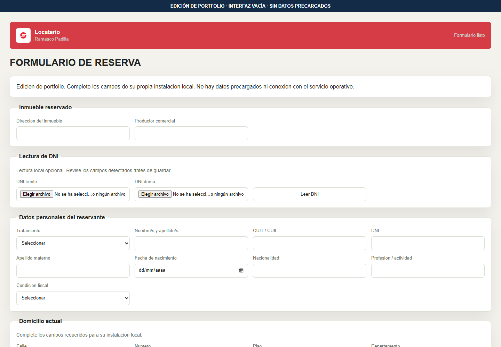
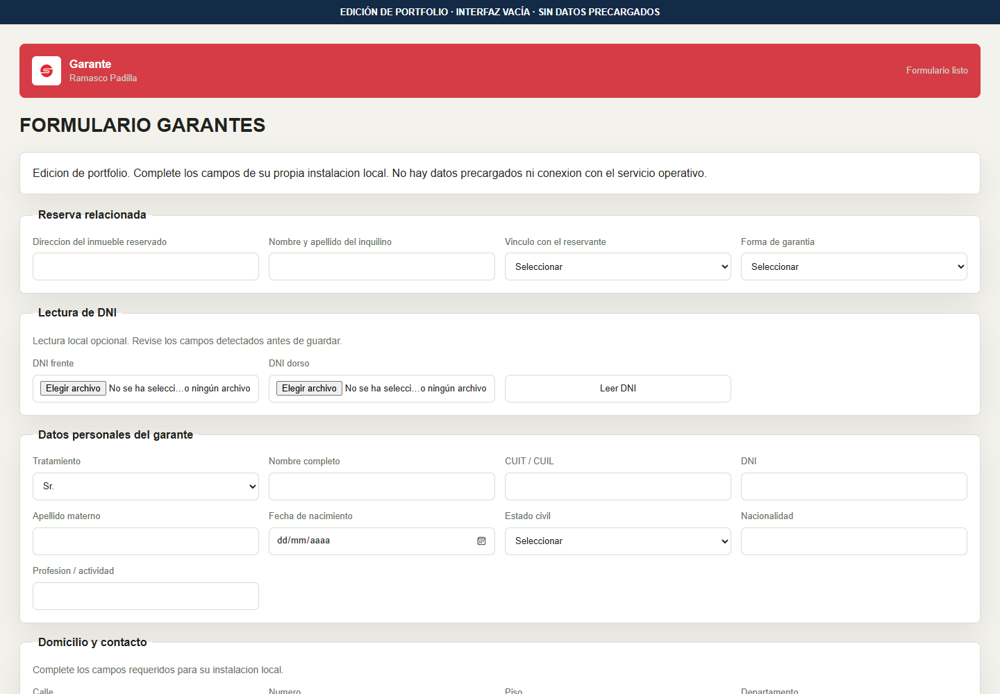
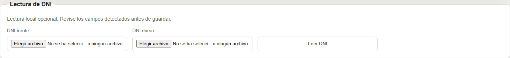
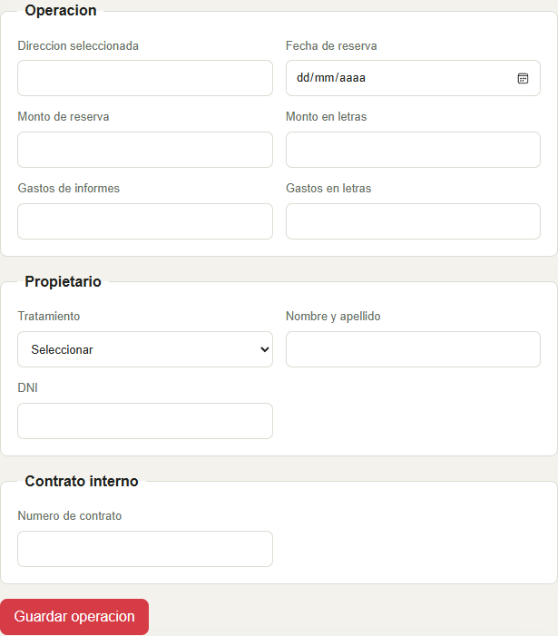
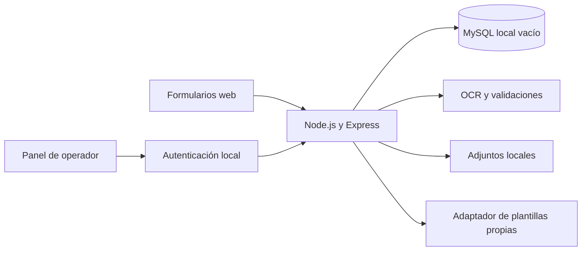

# Padilla Contratos — automatización documental

[English](README_EN.md)

Código de una aplicación para coordinar formularios, información de participantes y generación documental en procesos inmobiliarios. Combina una interfaz web, una API, persistencia relacional y lectura asistida de documentos mediante OCR.

**Esta edición fue preparada para exposición técnica.** No contiene registros, documentos, plantillas, datos de ejemplo, direcciones operativas ni accesos de la instalación del cliente. Se conserva el logo como identificación del proyecto.


## El problema que aborda

Una operación inmobiliaria reúne información de varias personas y etapas: reserva, datos del locatario, garantías, adjuntos y documentación. Cuando esas piezas se gestionan por separado, resulta difícil mantener la misma información entre formularios, revisión interna y documentos.

El proyecto conecta esas etapas mediante formularios específicos y una API común. La información ingresada puede validarse, relacionarse con la operación y utilizarse en las siguientes tareas del circuito. La lectura documental asiste la carga; la revisión de los campos sigue formando parte del proceso.

## Recorrido de uso

| Actor o etapa | Interacción | Responsabilidad técnica |
|---|---|---|
| Locatario | Completa la reserva y aporta sus archivos. | Validar campos, recibir adjuntos y registrar la información. |
| Garante | Completa un formulario independiente. | Asociar su información con la operación correspondiente. |
| Lectura documental | Selecciona imágenes y revisa lo detectado. | Procesar la lectura, extraer campos y advertir inconsistencias. |
| Operador | Consulta la información agrupada y completa datos de la operación. | Aplicar permisos y coordinar la información relacionada. |
| Documentación | Solicita una salida a partir de información estructurada. | Utilizar un generador configurado por separado, sin duplicar la carga manual. |

La edición pública muestra el código del recorrido y sus límites. No incluye cuentas del cliente, operaciones, adjuntos ni una conexión al servicio operativo.


## Recorrido visual

### Formulario de reserva

Organiza la información del inmueble, el participante y sus adjuntos. La captura conserva la marca autorizada y todos los campos permanecen vacíos.



### Formulario de garante

Separa la carga de la garantía del formulario del locatario. La relación con la operación se establece mediante los campos correspondientes, sin mostrar ninguna operación real o de ejemplo.



### Lectura documental asistida

El control recibe imágenes del frente y dorso. Esta vista muestra únicamente los controles: no se adjuntó ni procesó ningún documento para la captura.



### Controles del operador

La interfaz permite completar los datos de la operación, el propietario y la referencia de contrato. Esta es una captura del formulario vacío, sin conexión a una base de datos; no acredita un recorrido integrado contra MySQL.




## Funcionalidades del código

- Formularios independientes para locatarios y garantes.
- API para validación, persistencia y asociación de participantes.
- Panel de operador con autenticación configurada localmente.
- Procesamiento de imágenes y códigos de documentos, validación de campos y revisión humana.
- Gestión de adjuntos aportados por el usuario en su propia instalación.
- Adaptador DOCX para plantillas privadas configuradas por separado.

## Arquitectura



**Tecnologías:** JavaScript, Node.js, Express, MySQL, Tesseract.js, ZXing, Sharp y JSZip.

## Decisiones de ingeniería

**Recorridos separados por participante.** Cada formulario pide la información que corresponde a su actor. El panel interno concentra las tareas de revisión y operación.

**Información relacionada en el backend.** La API vincula participantes, operaciones y documentos. Las validaciones se aplican también del lado del servidor para mantener reglas comunes entre interfaces.

**OCR con revisión humana.** La extracción contempla límites de tiempo, resultados parciales y validaciones de campos. El objetivo es asistir la carga sin convertir una lectura incompleta en un dato confirmado automáticamente.

**Documentos como una integración independiente.** La información estructurada se entrega a un generador, lo que permite separar datos, formato y contenido documental. En esta edición ese límite también protege las plantillas privadas.

## Trabajo de desarrollo

El trabajo técnico abarcó formularios, servicios backend, persistencia, validaciones e integración documental. La evolución del proyecto fue incremental: conectar los recorridos de los participantes, incorporar la lectura asistida y revisar errores de datos e interfaz.

El caso muestra cómo una aplicación combina reglas de negocio, procesamiento de archivos y tareas de usuario. No se publican cifras de ahorro, precisión OCR o volumen de operaciones porque este paquete no incorpora mediciones verificables de esos resultados.

## Cómo está organizado el código

| Componente | Responsabilidad |
|---|---|
| `app/` | Formularios, panel e interacción de usuario. |
| `backend/src/server.mjs` | API, validaciones, recepción de archivos y coordinación de servicios. |
| `backend/src/db.mjs` y `backend/schema.sql` | Conexión configurable y definición de tablas, sin registros. |
| `backend/src/dni-ocr.mjs` | Interpretación de lecturas y comprobaciones de campos. |
| `backend/src/operator-auth.mjs` | Protección de las operaciones internas de esta edición. |
| `backend/src/docx-generators.mjs` | Adaptador para plantillas que aporte el usuario. |
| `configure-local.mjs` y `docker-compose.yml` | Preparación de una instalación independiente. |


## Ejecutar localmente

Requiere Node.js 22 o posterior y MySQL 8, o Docker Compose. No se conecta a ningún servicio del cliente.

### Con Docker Compose

```bash
node configure-local.mjs
docker compose --env-file .env up --build
```

El primer comando crea credenciales aleatorias nuevas en un archivo local ignorado por Git. No reutiliza cuentas existentes ni imprime contraseñas. Consultar ese archivo local para acceder al panel.

Abrir `http://127.0.0.1:3000/locatario.html` o `http://127.0.0.1:3000/operador.html`. Los puertos del ejemplo están publicados únicamente en la interfaz local.

### Sin Docker

Crear una base MySQL nueva usando únicamente `backend/schema.sql`, que contiene definiciones de tablas y no registros. Definir las variables de `backend/.env.example` con credenciales locales elegidas por el usuario. Desde `backend/` ejecutar:

```bash
npm ci
node --env-file=.env src/server.mjs
```

## Generación documental y límites

Los cuerpos de contratos, recibos y documentos de garantes se excluyeron tanto de los archivos como del código. Las previsualizaciones privadas fueron sustituidas por un aviso.

El adaptador DOCX admite archivos propios llamados `fc1.docx`, `fc10.docx` y `garantes.docx` en una carpeta externa indicada por `PRIVATE_TEMPLATE_DIR`. Sustituye marcadores de campos como `{{reservation.tenant_full_name}}` y `{{operation.contract_number}}`; los marcadores deben estar contenidos en un mismo fragmento de texto XML. Este adaptador no reproduce las plantillas ni todas las reglas documentales del sistema operativo.

La generación PDF y la conversión DOCX a PDF quedan deshabilitadas con respuesta explícita hasta incorporar una implementación propia. El servicio de OCR externo se excluyó. Tesseract puede descargar sus archivos de idioma cuando el usuario activa la lectura local.

Esta edición no es un despliegue del sistema del cliente y no debe utilizarse con datos personales sin una revisión de seguridad y privacidad adecuada.

## Comprobaciones

Desde `backend/`:

```bash
npm test
npm run check
```

Las pruebas cubren entradas OCR vacías y la respuesta de los adaptadores cuando faltan integraciones privadas. No se incluyen documentos ni registros de prueba.

## Autor

[Juan Arese](https://github.com/JuanAresse) · [LinkedIn](https://www.linkedin.com/in/juan-arese/)
