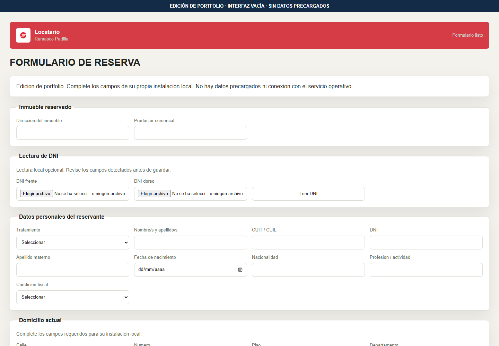
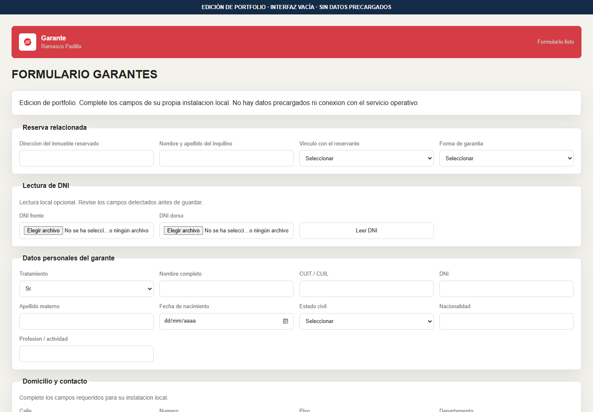
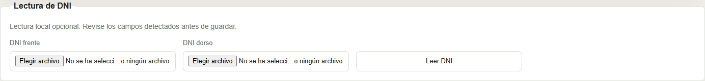
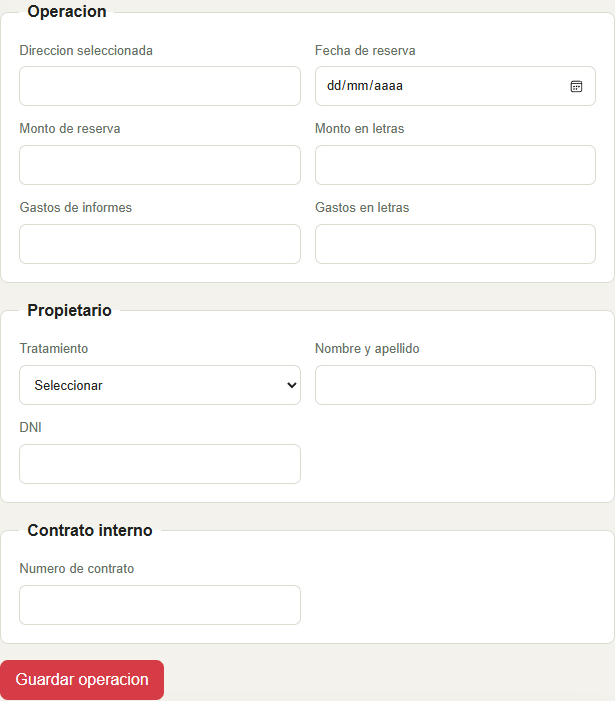

# Padilla Contratos — document workflow automation

[Español](README.md)

A portfolio source edition of a real estate workflow application combining participant forms, backend validation, relational storage, assisted document reading, and configurable document generation.

No customer records, sample records, attachments, templates, contractual text, operational domains, server addresses, or credentials are distributed. The project logo remains as visual identification.


## The problem

A real estate transaction involves several people and stages: reservation details, tenant information, guarantees, attachments, and documents. Managing those pieces separately makes it difficult to keep forms, internal review, and document outputs consistent.

The project connects those stages through dedicated forms and a shared API. Information can be validated, related to a transaction, and reused in subsequent steps. Document reading assists data entry; users still review the extracted fields.

## User journey

| Actor or stage | Interaction | Engineering responsibility |
|---|---|---|
| Tenant | Complete the reservation form and supply files. | Validate fields, receive attachments, and store information. |
| Guarantor | Complete a separate form. | Associate information with the relevant transaction. |
| Document reading | Select images and review extracted fields. | Process extraction and identify inconsistencies. |
| Operator | Review grouped information and transaction details. | Enforce permissions and coordinate related information. |
| Documents | Request output from structured information. | Use a separately configured renderer without repeated data entry. |

The public edition exposes the workflow code and its boundaries. It includes no customer accounts, transactions, attachments, or connection to the operational service.


## Visual walkthrough

### Reservation form

The form organizes property, participant, and attachment inputs. The authorized branding remains visible and all fields are empty.



### Guarantor form

A dedicated workflow separates guarantor information from the tenant form. No real or sample transaction is shown.



### Assisted document reading

Controls accept front and back images. No document was supplied or processed for this screenshot.



### Operator controls

The interface groups transaction, property-owner, and contract-reference fields. This screenshot shows the empty form without a database connection; it is not evidence of an integrated MySQL workflow.




## Engineering focus

Separate tenant and guarantor workflows connect to a Node.js/Express API and MySQL. OCR and barcode extraction assist data entry, while field validation and human review remain part of the workflow. Operator operations require locally configured authentication.

**Stack:** JavaScript, Node.js, Express, MySQL, Tesseract.js, ZXing, Sharp, and JSZip.

## Engineering decisions

**Separate participant workflows.** Dedicated forms request information appropriate to each actor, while the internal panel concentrates review and transaction tasks.

**Coordinate related information in the backend.** API validation provides shared rules across interfaces and links participants, transactions, and documents.

**Keep human review in document extraction.** Time limits, partial results, and field checks support assisted data entry. Incomplete extraction should not become confirmed information automatically.

**Treat rendering as an independent integration.** Structured information is separate from document layout and wording. The public adapter also establishes a boundary around private templates.

## Development work

The engineering work covered forms, backend services, persistence, validation, and document integration. Incremental development connected participant workflows, added assisted reading, and addressed data and interface errors.

No time-saving, OCR-accuracy, or transaction-volume metrics are claimed because this package does not include verifiable measurements of those outcomes.

## Code organization

`app/` contains forms and interface behavior. `server.mjs` coordinates API operations and file processing. Database configuration and table definitions are separate from OCR parsing, operator authentication, and document adapters. `configure-local.mjs` and `docker-compose.yml` prepare an independent installation.


## Run locally

With Node.js 22 or later and Docker Compose:

```bash
node configure-local.mjs
docker compose --env-file .env up --build
```

The configuration script generates new random local credentials in an ignored `.env` file. It does not distribute or reuse operational accounts. Open `http://127.0.0.1:3000/locatario.html` or `/operador.html`; consult your local configuration for operator credentials. Ports bind to the local interface only.

Alternatively, initialize a new MySQL 8 database with `backend/schema.sql`, configure local environment variables using `backend/.env.example`, and run `npm ci` followed by `node --env-file=.env src/server.mjs` from `backend/`.

## Document generation boundaries

All private layouts, legal text, document bodies, and previews were removed. The DOCX adapter accepts privately owned templates configured through `PRIVATE_TEMPLATE_DIR`. It replaces markers such as `{{reservation.tenant_full_name}}` within a single XML text fragment. It does not reproduce the original document engine in full.

PDF generation and DOCX-to-PDF conversion return an explicit unavailable status until a private integration is supplied. External OCR service integration is excluded. Tesseract may download language files when local OCR is activated.

This is an independently configurable source edition, not a deployment of the customer system.

## Checks

Run `npm test` and `npm run check` from `backend/`. Public tests cover empty OCR input, missing templates, and excluded integrations. No record or document fixtures are included.

[Juan Arese](https://github.com/JuanAresse) · [LinkedIn](https://www.linkedin.com/in/juan-arese/)
